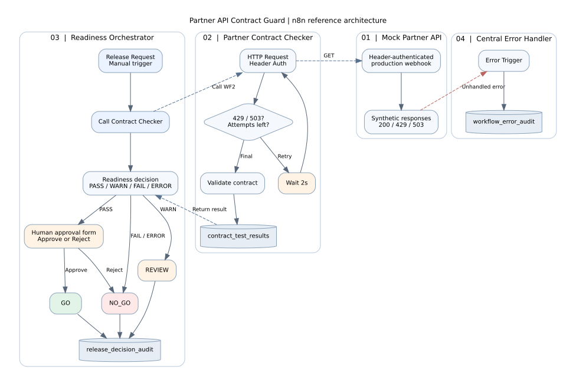

# Partner API Contract Guard

An n8n project for checking API compatibility before a partner integration is released.

A partner API can return HTTP 200 and still break an integration. A field might be renamed, a number might arrive as a string, or an empty response might be treated as valid data. I built this project to test those cases and connect the results to a simple release decision, rather than treating an HTTP success response as proof that an integration is safe to release.

The project uses **four n8n workflows**, a mock API with synthetic customer records, three Data Tables and a human approval step. It is a working portfolio prototype, not a production integration or a custom n8n node.



## How it works

| Workflow | Purpose |
|---|---|
| [01 · Mock Partner API](workflows/01-mock-partner-api.json) | An authenticated webhook that returns synthetic customer data. The `scenario` parameter controls valid responses, contract changes and simulated API failures. |
| [02 · Partner Contract Checker](workflows/02-partner-contract-checker.json) | Calls the mock API, handles selected retryable HTTP responses, validates the returned data and records the result. |
| [03 · Partner Readiness Orchestrator](workflows/03-readiness-orchestrator.json) | Calls the contract checker and uses its verdict to block, hold for review or request human approval. It saves the final decision. |
| [04 · Central Error Handler](workflows/04-central-error-handler.json) | Captures unexpected workflow execution failures and writes them to an error audit table. It is configured as the error workflow for Workflow 1. |

I kept the responsibilities separate. The contract checker decides whether the API response meets the expected shape. The readiness workflow decides what that result means for a proposed release. An unexpected execution failure is handled separately from a normal HTTP error response.

### Release decisions

| Contract result | What happens | Recorded decision |
|---|---|---|
| `PASS` with HTTP 200 | A reviewer is asked to approve or reject | `GO` if approved with a name; otherwise `NO_GO` |
| `WARN` | No approval form; further review is needed | `REVIEW` |
| `FAIL` | Release is blocked | `NO_GO` |
| `ERROR` | Release is blocked | `NO_GO` |

A `GO` decision is **an audit outcome, not an automated deployment**. The approval form asks for a name, but it does not authenticate the reviewer. That distinction matters if this design is taken beyond a demonstration.

## What I tested

I ran the workflows in n8n Cloud and checked the execution outputs and audit records. These are manual end-to-end checks, not an automated test suite.

| Test | Observed result |
|---|---|
| Valid API response (`v1_ok`) | HTTP 200, `PASS`, three customer records |
| Renamed required field (`v2_rename`) | `FAIL` because `customer_id` is missing |
| Incorrect field type (`v2_type_drift`) | `FAIL` because `credit_limit` is a string |
| Null required value (`null_email`) | `FAIL` |
| Empty response with a count of three (`empty_200`) | `FAIL` |
| Extra optional field (`v2_additive`) | `WARN` |
| Request without the API key | HTTP 403 |
| Temporary rate limit (`rate_429_once`) | First request HTTP 429; second request HTTP 200; final contract verdict `PASS` |
| Simulated outage (`down_503`) | Three HTTP 503 responses; final verdict `ERROR` |
| Reviewer approval and rejection | `GO` and `NO_GO`, respectively |
| Failed contract and additive change | Automatic `NO_GO` and `REVIEW`, without requesting approval |
| Invalid scenario | Workflow 1 failed and Workflow 4 recorded the error |

The retry demonstration is deliberately deterministic: the mock API reads an `attempt` query parameter and returns HTTP 429 on the first attempt, then valid data on the second. It shows the retry path working; it is not a test against a real third-party rate limiter.

The full [test record](docs/test-matrix.md) includes checks I did not implement, such as duplicate-request prevention and timeout handling.

## Execution evidence

I captured screenshots from the n8n editor, execution history and Data Tables after running the tests. The workflows and their results are easier to assess together, so I have included both the exported definitions and the evidence below.

### Workflow design

| Workflow | Screenshot |
|---|---|
| Mock Partner API | [01 · Webhook and response generation](docs/screenshots/01-mock-partner-api.png) |
| Partner Contract Checker | [02 · Validation and retry loop](docs/screenshots/02-partner-contract-checker.png) |
| Release Readiness Orchestrator | [03 · Approval and release decision flow](docs/screenshots/03-readiness-orchestrator.png) |
| Central Error Handler | [04 · Unexpected error capture](docs/screenshots/04-central-error-handler.png) |

### Retry, release decisions and failure handling

| Evidence | Screenshot |
|---|---|
| First HTTP request returned 429 | [05a · Rate limit response](docs/screenshots/05a-http-429-first-attempt.png) |
| Second HTTP request returned 200 | [05b · Successful retry](docs/screenshots/05b-http-200-second-attempt.png) |
| Contract check finished with `PASS` | [05c · Final contract result](docs/screenshots/05c-retry-final-pass.png) |
| Release decisions written to the audit table | [06 · GO, NO_GO and REVIEW](docs/screenshots/06-release-decision-audit.png) |
| Invalid scenario written to the error audit table | [07 · Central error audit](docs/screenshots/07-central-error-audit.png) |

The retry run returned HTTP 429 at **14:51:27 UTC on 18 November 2026** and HTTP 200 at **14:51:29 UTC**. The final result was `PASS` with three synthetic records. The two timestamps are consistent with the configured two-second retry wait.

The screenshot links assume the images are stored in `docs/screenshots/` using the filenames shown above. Screenshots do not replace live execution logs, which are not included in the repository.

## Contract checks and retry policy

The v1 contract expects each record to contain these non-null fields:

| Field | Required type |
|---|---|
| `customer_id` | String |
| `email` | String |
| `credit_limit` | Number |
| `updated_at` | String |

The response also needs an `items` array and a `total_count` matching the number of returned records. Missing fields, nulls, type mismatches and count mismatches produce `FAIL`. An unexpected extra field produces `WARN` rather than an automatic failure.

For HTTP **429** and **503**, Workflow 2 retries up to **three total requests**, waiting a fixed **two seconds** between attempts. The current version does not use `Retry-After` or exponential backoff. It treats other non-200 HTTP responses as `ERROR`, without that retry loop.

Three Data Tables hold the final results:

- `contract_test_results` records the contract verdict, status, checks and warnings.
- `release_decision_audit` records the release request, final decision and reviewer input when applicable.
- `workflow_error_audit` records unexpected execution failures, including the failed workflow, node and error message.

The table columns are documented in [docs/data-tables.md](docs/data-tables.md).

## Running the project in another n8n workspace

The JSON files in [`workflows/`](workflows/) are sanitised copies. They do **not** run immediately after import because credentials, URLs, workflow references and Data Table IDs are specific to each workspace.

1. Use an n8n workspace that supports Data Tables, sub-workflows and Wait-node forms. Create the three Data Tables using [these column definitions](docs/data-tables.md).
2. Import the four workflow JSON files into n8n.
3. Create a new Header Auth credential using header name `X-API-Key` and a test secret of your choice. Configure it in Workflow 1's Webhook and Workflow 2's HTTP Request. Do not store the key in GitHub.
4. Re-select the appropriate Data Table in each Data Table node and check the column mappings.
5. Publish Workflow 1. Copy its **production webhook URL** into Workflow 2's HTTP Request node. Keep `scenario` and `attempt` as query parameters and their values in Expression mode.
6. In Workflow 3's **Run Partner Contract Check** node, select the imported Workflow 2. Map `release_id`, `connector_id`, `scenario` and `requested_by`; keep **Wait for Sub-Workflow Completion** enabled.
7. Publish Workflow 4. In Workflow 1's settings, assign Workflow 4 as its **Error Workflow** and save or republish the change as needed.
8. Run Workflow 3 with `scenario = v1_ok`, approve the form with a demo reviewer name, and check `release_decision_audit`. Then try `v2_rename` and `v2_additive` to see the blocked and review decisions.

For a reliability check, use `rate_429_once` and inspect the two runs of the HTTP Request node in Workflow 2.

## Scope and limitations

I deliberately kept the first version small enough to build, understand and test end to end. Before using the same pattern with real partners, I would address:

- **Authenticated approvals:** the current form accepts a typed name; it does not enforce reviewer identity, authorisation or an expiry time.
- **Idempotency:** repeated release IDs create new audit rows. There is no duplicate-decision prevention.
- **Connector allowlisting:** `connector_id` is carried through and logged, but it is not validated against an approved connector list.
- **Retry and timeout handling:** the delay is fixed; there is no `Retry-After` support, backoff policy or dedicated timeout test.
- **Operational response:** Workflow 4 is attached to Workflow 1, not all four workflows. The prototype logs errors but does not send alerts or assign incidents.
- **Review workflow:** `WARN` creates a `REVIEW` audit outcome, not an assigned follow-up task.

Those are limitations of the current implementation, not features that have already been tested or delivered.

## Repository contents

```text
README.md
workflows/
  01-mock-partner-api.json
  02-partner-contract-checker.json
  03-readiness-orchestrator.json
  04-central-error-handler.json
docs/
  architecture.svg
  architecture.png
  architecture.mmd
  data-tables.md
  security-review.md
  test-matrix.md
  screenshots/
    01-mock-partner-api.png
    02-partner-contract-checker.png
    03-readiness-orchestrator.png
    04-central-error-handler.png
    05a-http-429-first-attempt.png
    05b-http-200-second-attempt.png
    05c-retry-final-pass.png
    06-release-decision-audit.png
    07-central-error-audit.png
tools/
  validate_exports.py
```

`tools/validate_exports.py` checks the published workflow JSON for file structure, node connections and selected environment-specific values. It does **not** execute the workflows in n8n.

All customer records and API failures in this project are simulated. The original n8n credentials, workspace URLs and internal IDs are not included in the public workflow exports.

Useful references: [n8n import/export](https://docs.n8n.io/workflows/export-import/) · [Sub-workflows](https://docs.n8n.io/flow-logic/subworkflows/) · [Error handling](https://docs.n8n.io/flow-logic/error-handling/) · [Data Tables](https://docs.n8n.io/data/data-tables/)
